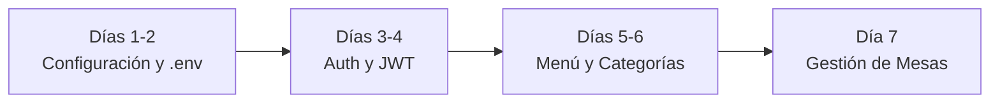
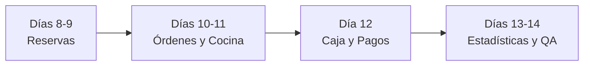

# 📋 Plan Maestro de Implementación — RestaurantHub API (2 Semanas)

> **Objetivo:** Llevar la API de RestaurantHub desde su estado inicial hasta un producto funcional, robusto y listo para entregar en un plazo de 14 días (2 semanas).  
> **Stack:** Node.js (ES Modules), Express, MySQL 8 (`mysql2/promise`), JWT y Bcrypt.

---

## 📊 Estado Actual del Proyecto
- [x] Motor de base de datos MySQL configurado y conectado (`restaurantHub`).
- [x] Pool de conexiones preparado con soporte de promesas en [`src/db.js`](file:///C:/Users/isft118/Desktop/teko/teko/API/src/db.js).
- [x] Función base de inserción `crearUsuario` con placeholders `(?, ?, ?, ?)` en [`model/usuario.model.js`](file:///C:/Users/isft118/Desktop/teko/teko/API/model/usuario.model.js).
- [x] Rutas y controlador de registro iniciales enlazados.

---

## 🛠️ Fase 0: Preparación y Dependencias (Día 0)

Antes de programar la lógica de negocio, instala los paquetes esenciales:

```bash
npm install dotenv bcrypt jsonwebtoken cors
```

### Variables de Entorno (`.env`)
Crear el archivo `.env` en la raíz del proyecto para no exponer contraseñas:
```env
PORT=3000
DB_HOST=localhost
DB_USER=root
DB_PASSWORD=isft118
DB_NAME=restaurantHub
JWT_SECRET=super_secreto_restauranthub_2026
JWT_EXPIRES_IN=24h
```

---

## 🗓️ SEMANA 1: Cimientos, Seguridad y Catálogos Maestros



### 📌 Día 1 y 2: Arquitectura Limpia y Conexión Centralizada
* [ ] **Cargar variables de entorno**: Configurar `dotenv.config()` en el punto de entrada.
* [ ] **Middleware globales**: Habilitar `cors()` y `express.json()` en `app.js`.
* [ ] **Estandarizar respuestas**: Crear helper de respuesta JSON uniforme (`{ success: true, data, message }`).
* [ ] **Prueba de fuego**: Levantar servidor con `npm run dev` y comprobar ping a la base de datos.

### 📌 Día 3 y 4: Módulo de Autenticación y Usuarios
* [ ] **Hasheo de contraseñas**:
  * Integrar `bcrypt.hash(password, 10)` antes de ejecutar la consulta `INSERT` en el modelo.
* [ ] **Validaciones de entrada (`utils/validation.js`)**:
  * Regex de email válido.
  * Requisitos de contraseña (mínimo 8 caracteres, mayúscula, minúscula, número y símbolo).
  * Validación de nombre y apellido (solo letras, entre 2 y 50 caracteres).
* [ ] **Controlador de Login (`POST /api/auth/login`)**:
  * Buscar usuario por email.
  * Validar contraseña con `bcrypt.compare`.
  * Generar y retornar token JWT (`jwt.sign({ id, role }, ...)`).
* [ ] **Middleware de Protección (`middlewares/auth.middleware.js`)**:
  * Verificar token en el encabezado `Authorization: Bearer <token>`.
  * Middleware para control de rol de administrador (`requireAdmin`).

### 📌 Día 5 y 6: Módulo de Menú y Categorías
* [ ] **Categorías (`/api/categories`)**:
  * `GET /`: Obtener todas las categorías.
  * `POST /`: Crear categoría (protegida para administradores).
  * `PUT /:id`: Actualizar nombre/descripción.
  * `DELETE /:id`: Eliminar categoría.
* [ ] **Platos del Menú (`/api/menu`)**:
  * `GET /`: Listar platos activos con filtro opcional por categoría (`?category=...`).
  * `GET /:id`: Detalle de un plato específico.
  * `POST /`: Crear nuevo plato (nombre, descripción, precio, categoría, disponibilidad).
  * `PUT /:id`: Editar información o precio.
  * `PATCH /:id/availability`: Cambiar estado disponible/no disponible.

### 📌 Día 7: Módulo de Gestión de Mesas
* [ ] **Mesas (`/api/tables`)**:
  * `GET /`: Listado de mesas y su estado actual (`libre`, `ocupada`, `reservada`, `en limpieza`).
  * `POST /`: Registrar mesa (número de mesa, capacidad de comensales, sector/ubicación).
  * `PATCH /:id/status`: Actualización rápida de estado (ej: mozo pasa la mesa a "ocupada").
  * `DELETE /:id`: Dar de baja mesa.

---

## 🗓️ SEMANA 2: Lógica de Negocio, Operaciones y Cierre



### 📌 Día 8 y 9: Módulo de Reservas
* [ ] **Lógica de disponibilidad**:
  * Comprobar que la mesa solicitada no tenga otra reserva confirmada en la misma franja horaria.
  * Validar que la cantidad de personas no supere la capacidad de la mesa.
* [ ] **Endpoints (`/api/reservations`)**:
  * `POST /`: Crear reserva (asociada al usuario autenticado).
  * `GET /`: Listar reservas activas del día (para recepción).
  * `GET /mis-reservas`: Listar historial del cliente logueado.
  * `PATCH /:id/cancel`: Cancelar reserva y liberar la mesa.

### 📌 Día 10 y 11: Módulo de Comandas y Órdenes
* [ ] **Creación de Orden con Transacciones SQL (`/api/orders`)**:
  * Implementar `START TRANSACTION`:
    1. Insertar cabecera de orden en tabla `orders` (mesa, mozo/usuario, estado inicial `pendiente`).
    2. Insertar cada plato en tabla `order_items` (orden_id, plato_id, cantidad, precio unitario).
    3. Actualizar estado de la mesa a `ocupada`.
    4. Ejecutar `COMMIT` (o `ROLLBACK` ante cualquier fallo).
* [ ] **Flujo de Cocina y Mozos**:
  * `GET /`: Ver órdenes pendientes y en cocina.
  * `PATCH /:id/status`: Transicionar estado (`pendiente` ➔ `en preparación` ➔ `lista` ➔ `entregada`).

### 📌 Día 12: Módulo de Caja y Facturación
* [ ] **Apertura y Cierre de Caja (`/api/cash-registers`)**:
  * `POST /open`: Abrir turno de caja con monto inicial.
  * `POST /close`: Cerrar turno calculando el total recaudado.
* [ ] **Pagos / Transacciones (`/api/transactions`)**:
  * `POST /`: Registrar cobro de una orden (medio de pago: efectivo, débito, crédito).
  * Actualizar orden a `pagada` y mesa a `libre` o `en limpieza`.

### 📌 Día 13: Reportes y Estadísticas
* [ ] **Consultas SQL de agregación (`/api/stats`)**:
  * Total de recaudación del día/mes.
  * Top 5 platos más vendidos (`JOIN order_items` + `COUNT/SUM`).
  * Horarios o días con mayor ocupación de mesas.

### 📌 Día 14: Pruebas Integrales, Colección de Postman y Entrega
* [ ] **Manejo global de errores**: Middleware final para capturar errores no controlados y responder con códigos HTTP correctos (`400`, `401`, `403`, `404`, `500`).
* [ ] **Prueba de flujo completo E2E**:
  1. Registrar usuario cliente y usuario admin.
  2. Login y obtención del JWT.
  3. Crear platos y categorías como admin.
  4. Reservar mesa como cliente.
  5. Crear comanda/orden de consumo.
  6. Cambiar estados de cocina.
  7. Cobrar la orden en caja y liberar la mesa.
* [ ] **Documentación**: Exportar la colección completa de Postman/Thunder Client con ejemplos de cada petición.

---

## 🎯 Reglas de Oro para el Éxito

1. **Un endpoint a la vez**: No saltes de archivo sin probar en Postman/Thunder Client que el endpoint actual devuelva el código HTTP esperado (`200 OK`, `201 Created`, etc.).
2. **Consultas siempre parametrizadas**: Nunca concatenes variables a tus cadenas SQL; usa siempre placeholders `?` para evitar inyecciones.
3. **Commit diario en Git**: Haz un commit al finalizar cada día del plan con un mensaje claro (ej: `feat(menu): crud completo de platos y categorias`).
